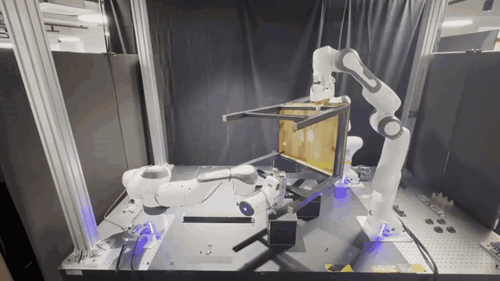
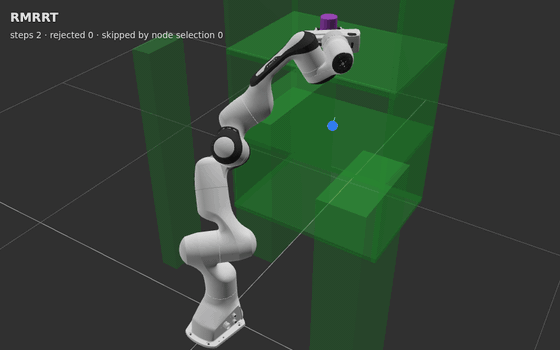
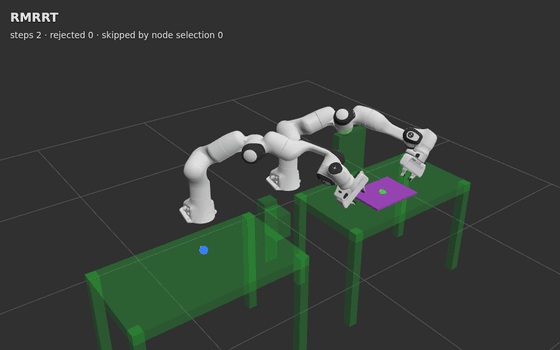
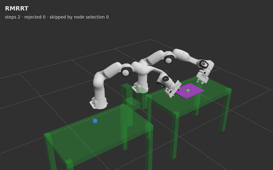
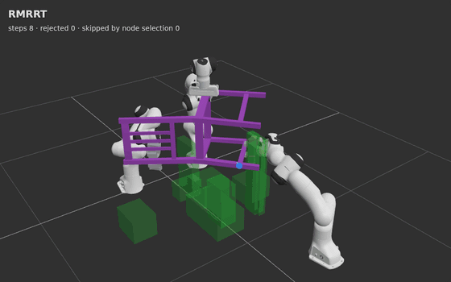
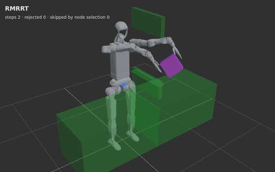
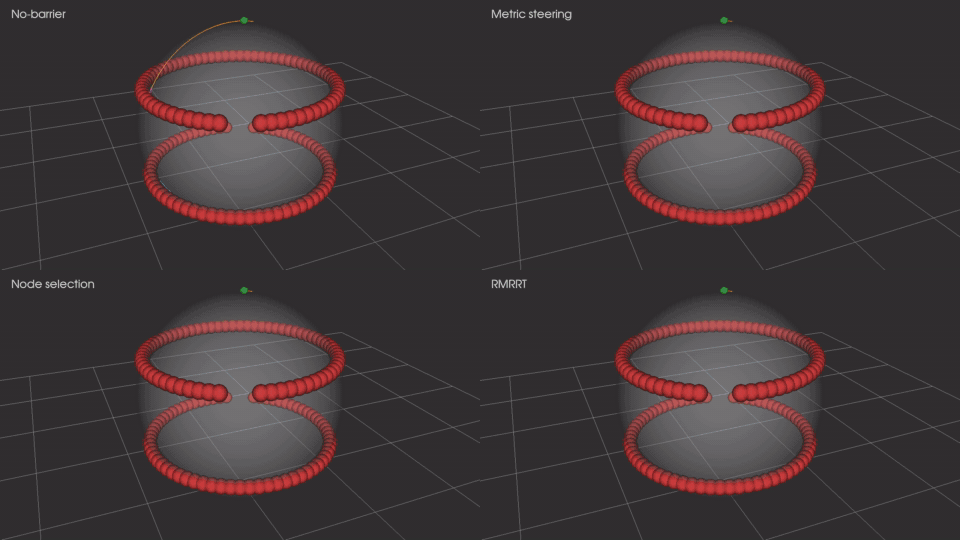
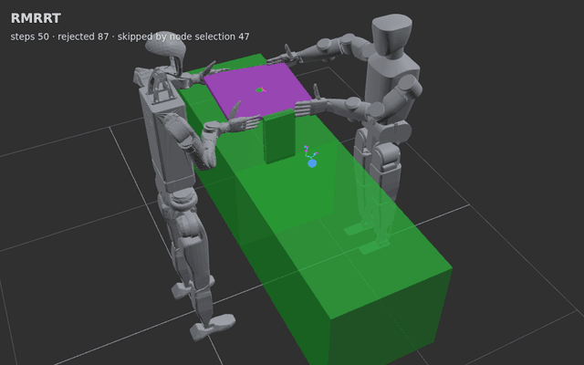

<div align="center">

# RMRRT: Riemannian Barrier Metric RRT<br>for Inequality-Aware Steering on Equality Manifolds

<p><strong>IEEE Transactions on Robotics (T-RO), 2026</strong></p>

<p>
  <a href="https://rcilab.khu.ac.kr/rmrrt/"></a>
  <a href="https://rcilab.khu.ac.kr/rmrrt/static/paper/RMRRT_TRO2026.pdf"></a>
  <a href="https://youtu.be/bnW1Kop4qRw"></a>
  <a href="LICENSE"></a>
</p>



</div>

**RMRRT** plans motions for robots whose configurations must satisfy equality constraints: arms that hold
one object together, a tool kept upright. It runs RRT-Connect on the constraint manifold and turns the
nearby inequality constraints (obstacle clearance, self-collision clearance and joint-limit margins) into a
Riemannian barrier metric on the tangent space. Each step bends away from the bounds it comes close to
(*centered steering*), and a node is extended only when the step the metric predicts from it gets closer to
the target (*Riemannian node selection*). Fewer steps are thrown away by the collision check, and the
collision check still decides what is valid.

## Index

- [Gallery](#gallery)
- [Quick Start (Docker)](#quick-start-docker)
- [Installation](#installation)
- [Examples](#examples)
- [Options and parameters](#options-and-parameters)
- [Code structure](#code-structure)
- [Using RMRRT on your own problem](#using-rmrrt-on-your-own-problem)
- [Citation](#citation)
- [License](#license)

## Gallery

| S1 · one arm keeps a cup upright | S2 · two arms carry a tray |
| :---: | :---: |
|  |  |
| **S3 · two arms keep the tray level** | **S4 · three arms carry a chair among boxes** |
|  |  |
| **S5 · a humanoid carries a box through a window** | **Sphere** · `no_metric`, `steer`, `select`, `rmrrt` |
|  |  |
| **Two humanoids, one tray** (28 joints, one closed chain) | **Hardware** · three arms, one chair |
|  |  |

The trees are drawn where the carried object is at each node: start tree orange, goal tree light blue,
steps rejected by the collision check magenta, path yellow.

## Quick Start (Docker)

```bash
git clone https://github.com/rcilab/rci_rmrrt.git
cd rci_rmrrt
docker build -t rmrrt .                      # ROS Noetic, MoveIt, the robot packages and this workspace
                                             # (--build-arg JOBS=8 compiles faster with enough memory)

xhost +local:docker                          # only for RViz
docker run -it --rm --net=host -e DISPLAY -v /tmp/.X11-unix:/tmp/.X11-unix rmrrt

# inside the container
rosrun rmrrt sphere_benchmark                # no robot needed
roslaunch rmrrt robot.launch scenario:=panda_dual > /dev/null &
rosrun rmrrt benchmark -E panda_dual -M all
```

## Installation

Ubuntu 20.04 with [ROS Noetic](http://wiki.ros.org/noetic/Installation/Ubuntu) and
[MoveIt](https://moveit.ros.org/install/).

```bash
sudo apt install ros-noetic-moveit ros-noetic-franka-description python3-catkin-tools python3-vcstool \
                 libyaml-cpp-dev libboost-program-options-dev

mkdir -p ~/rmrrt_ws/src && cd ~/rmrrt_ws/src
git clone https://github.com/rcilab/rci_rmrrt.git
vcs import < rci_rmrrt/dependencies.repos    # robot packages of the Panda scenarios, pinned

cd ~/rmrrt_ws
catkin config --extend /opt/ros/noetic --cmake-args -DCMAKE_BUILD_TYPE=Release
catkin build -j4                             # about 1 GB of memory per job
source devel/setup.bash
```

Unit tests: `catkin test rmrrt`.

## Examples

### Sphere (no robot)

The unit sphere in R³ with balls cut out of it. The four methods run on the same instances.

```bash
rosrun rmrrt sphere_benchmark                                   # double_gate, h = 0.15, 100 instances
rosrun rmrrt sphere_benchmark --layout gate --h 0.25 --instances 50
roslaunch rmrrt sphere_demo.launch                              # one instance per method in RViz
roslaunch rmrrt sphere_demo.launch layout:=clutter instance:=3  # layout: open | clutter | gate | double_gate
```

### Robot scenarios

| | `-E` | Robot and task |
| --- | --- | --- |
| S1 | `panda_orientation` | a Panda keeps a cup upright |
| S2 | `panda_dual` | two Pandas carry a tray |
| S3 | `panda_dual_orientation` | two Pandas carry a tray kept level |
| S4 | `panda_triple` | three Pandas carry a chair |
| S5 | `h1_2_dual` | a Unitree H1-2 carries a box with both hands |

Each scenario takes two terminals: the first loads the robot, the second plans.

```bash
# terminal 1
roslaunch rmrrt robot.launch scenario:=panda_dual
# terminal 2
rosrun rmrrt benchmark -E panda_dual               # RMRRT on the ten queries
rosrun rmrrt benchmark -E panda_dual -M all        # rmrrt, steer, select and no_metric
rosrun rmrrt benchmark -E panda_dual --scene 2     # one query
```

One query in RViz, the search replayed where the carried object is and the path animated:

```bash
# terminal 1
roslaunch rmrrt view.launch scenario:=panda_dual
# terminal 2
rosrun rmrrt view -E panda_dual --scene 2
rosrun rmrrt view -E panda_dual --scene 2 -M no_metric
```

<details>
<summary>Commands of every scenario</summary>

```bash
roslaunch rmrrt robot.launch scenario:=panda_orientation          # S1
rosrun rmrrt benchmark -E panda_orientation -M all

roslaunch rmrrt robot.launch scenario:=panda_dual                 # S2
rosrun rmrrt benchmark -E panda_dual -M all

roslaunch rmrrt robot.launch scenario:=panda_dual_orientation     # S3
rosrun rmrrt benchmark -E panda_dual_orientation -M all

roslaunch rmrrt robot.launch scenario:=panda_triple               # S4
rosrun rmrrt benchmark -E panda_triple -M all

roslaunch rmrrt robot.launch scenario:=h1_2_dual                  # S5
rosrun rmrrt benchmark -E h1_2_dual -M all
```

The viewer takes the same scenarios: `roslaunch rmrrt view.launch scenario:=<scenario>` and
`rosrun rmrrt view -E <scenario> --scene <1-10> [-M <method>]`.

</details>

## Options and parameters

| Option | `benchmark` | `view` |
| --- | --- | --- |
| `-E <scenario>` | the scenario (required) | the scenario (required) |
| `-M <method>` | `rmrrt` (default), `steer`, `select`, `no_metric` or `all` | `rmrrt` (default), `steer`, `select`, `no_metric` |
| `--scene <1-10>` | one query (default: all ten) | the query (default: 1) |
| `--timeout <s>` | seconds per query (default: 30) | |
| `--seed <n>` | one random seed for every query (default: the seed of each query) | |
| `--duration <s>` | | seconds of one pass of the path animation (default: 10) |

`steer` uses only the metric steering of RMRRT, `select` only its node selection, `no_metric` neither.

**Queries.** `rmrrt/scenes/<scenario>/scene_0001` to `scene_0010`: `scene.yaml` (the random seed and the
boxes of the query), `start_q.txt` and `goal_q.txt` (joint values, in the order of the scenario's groups in
[`rmrrt/config/scenarios.yaml`](rmrrt/config/scenarios.yaml)).

**Results.** `benchmark` prints each query and the means over the queries, and writes
`rmrrt/results/<scenario>/<method>.csv` with one row per query: `solved`, `seconds`, `checks` (calls of the
collision check), `path_length` (joint space, rad), `iterations`, `nodes`, `rejected` (steps the collision
check rejected) and `declined` (extensions the node selection skipped).

**Parameters.** [`rmrrt/config/planner.yaml`](rmrrt/config/planner.yaml), the same for every scenario:

| Parameter | Value | Meaning |
| --- | --- | --- |
| `step_size` | 0.2 rad | length of every step |
| `connection_tolerance` | 0.2 rad | the trees connect within this distance |
| `projection_tolerance` | 0.002 | a configuration is on the manifold when ‖g(q)‖ is below it |
| `edge_resolution` | 0.01 rad | spacing of the collision checks along an edge |
| `timeout` | 30 s | per query |
| `beta` | 0.5 | weight of the barrier push in the steering |
| `barrier_width` | 0.15 m, 0.05 m, 0.2 rad | obstacles, self-collision and joint limits closer than this enter the metric |

## Code structure

```
rci_rmrrt/
├── Dockerfile, dependencies.repos      Docker image and the pinned robot packages
├── assets/videos/                      README media
└── rmrrt/                              the catkin package
    ├── include/rmrrt/, src/
    │   ├── core/        types, Margin, ProblemBase: the interface of a planning problem
    │   ├── metric/      Barrier (w, c), RiemannianMetric: the chart G, P, Q at a configuration
    │   ├── geometry/    capsule-box and capsule-capsule distances, CapsuleMargins (h and ∇h)
    │   ├── steering/    SteeringBase → SteeringEuclidean, SteeringMetric, SteeringCentered (+ factory)
    │   ├── selection/   SelectionBase → SelectionNearest, SelectionRiemannian (+ factory)
    │   ├── planner/     RRTConnect, MotionTree, NewtonProjection, Method (the four methods)
    │   └── robot/       MoveIt layer: ScenarioSpec, MoveitKinematics, RobotScene, GraspConstraint,
    │                    RobotProblem, Experiment, PlannerConfig, RobotView
    ├── apps/            benchmark, view
    ├── examples/sphere/ SphereProblem, sphere_benchmark, sphere_demo
    ├── test/            unit tests (gtest)
    ├── config/          planner.yaml, scenarios.yaml
    ├── launch/          robot.launch, view.launch, sphere_demo.launch
    ├── robots/          Unitree H1-2 (S5) and the chair mesh (S4)
    └── scenes/          ten queries per scenario: scene.yaml (seed, boxes), start_q.txt, goal_q.txt
```

The planner core (`rmrrt` library) depends on Eigen only; the MoveIt layer (`rmrrt_robot`) builds a
`ProblemBase` for each query. One iteration of `RRTConnect::solve`:

```
sample q_rand uniformly in the joint limits
q_near = selection.select(tree_a, q_rand)               # -1: declined, no collision check
q_new  = extend(tree_a, q_near, q_rand)                  # steer, project onto g(q) = 0, check
connect tree_b toward q_new step by step                 # selection.accepts() before each step
if the trees meet and the last edge is valid: return the path
swap(tree_a, tree_b)
```

`extend` builds the chart at the node once (`MotionTree::chart`), takes a step of length η in the
direction of the steering, projects it with the minimum-G-norm Newton correction and checks the state and
the edge. A centered step the collision check rejects is tried once more with the metric steering.

## Using RMRRT on your own problem

Implement `rmrrt::ProblemBase`: the equality constraint, the sampling box, the margins near their bounds
and the validity check. The sphere example ([`examples/sphere/sphere_problem.hpp`](rmrrt/examples/sphere/sphere_problem.hpp))
is a complete one in 50 lines.

```cpp
#include "rmrrt/planner/method.hpp"

class MyProblem : public rmrrt::ProblemBase
{
  int dim() const override;                                         // n
  int coDim() const override;                                       // m
  void function(rmrrt::ConstRefVector q, rmrrt::RefVector g) const override;   // g(q)
  void jacobian(rmrrt::ConstRefVector q, rmrrt::RefMatrix J) const override;   // dg/dq, m x n
  const rmrrt::Vector& lowerBound() const override;
  const rmrrt::Vector& upperBound() const override;
  void computeMargins(rmrrt::ConstRefVector q, const rmrrt::Barrier& barrier,
                      rmrrt::Margins& margins) const override;     // h and ∇h of the inequalities below their width
  bool isValid(rmrrt::ConstRefVector q) const override;             // collision check
};

MyProblem problem;
rmrrt::RiemannianMetric metric;
rmrrt::RRTConnect planner(problem, metric);
rmrrt::configure(planner, rmrrt::findMethod("rmrrt"), 0.5);
if (planner.solve(start, goal, 30.0))
  use(planner.path());
```

## Citation

If you find RMRRT useful in your research, please cite:

```bibtex
@article{kang2026rmrrt,
  title   = {{RMRRT}: Riemannian Barrier Metric {RRT} for Inequality-Aware Steering on Equality Manifolds},
  author  = {Kang, Minhyeong and Kim, Sanghyun},
  journal = {IEEE Transactions on Robotics},
  year    = {2026}
}
```

## License

BSD-3-Clause, see [LICENSE](LICENSE). The robot and object models keep their own licenses, see
[`rmrrt/robots/README.md`](rmrrt/robots/README.md).
